WebGPU Forward+ and Clustered Deferred Shading
======================

University of Pennsylvania, CIS 5650: GPU Programming and Architecture, Project 4

* Anna Dai <!-- TODO:  add LinkedIn or personal site -->
* Tested on: Google Chrome 155.0.8059.39 on
  Windows 11 Home, AMD Ryzen 9 5950X (16 cores) 128 GB, NVIDIA GeForce RTX 3090 Ti (driver 32.0.16.1656)

[Live Demo](https://annaaaddddd.github.io/WebGPU-Forward-Plus-and-Clustered-Deferred) |
[Demo video](images/demoAllModes.mp4)

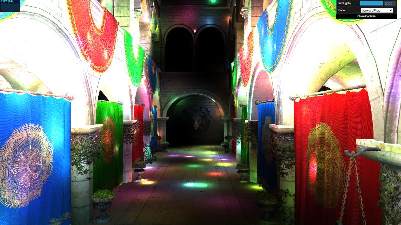

*Forward+ renderer, Sponza, 5000 point lights, cluster cap 1024.*

## Overview

This project renders the Sponza atrium under thousands of moving point lights and compares three
ways of shading it.

* Naive forward evaluates every light for every fragment.
* Forward+ first sorts the lights into a 3D grid of view-frustum clusters with a compute shader,
  so each fragment only loops over the lights near it.
* Clustered Deferred uses the same clusters, but writes a G-buffer first and does the lighting in a
  fullscreen pass, so lighting runs once per pixel.

Forward+ also has an optional depth prepass, and both clustered renderers have an optional cluster
culling step. Each of these is measured as a separate mode.

Main results, at 2560 x 1271 on an RTX 3090 Ti:

* At 5000 lights Clustered Deferred takes 9.0 ms, Forward+ 29.5 ms and naive 351.8 ms
  ([comparison](#naive-vs-forward-vs-clustered-deferred)).
* Most of Forward+'s extra lighting work is overdraw. A depth prepass removes it and makes Forward+
  2.0x to 2.6x faster from 2000 lights up ([Extra: Depth prepass](#extra-depth-prepass)).
* Cluster culling skips 85% of the non-empty clusters, but the clustering pass takes just as long
  ([Extra: Cluster culling](#extra-cluster-culling)).
* Doubling the depth slices (24 to 48) cuts the lighting passes by 24% to 31%. Doubling the tiles
  along each screen axis helps much less ([Cluster grid](#cluster-grid)).
* A second camera view with more overdraw keeps the same ranking ([Camera view](#camera-view)).

## Core features

### Light clustering

The view frustum is cut into 16 x 9 screen tiles and 24 depth slices, 3456 clusters in total.
Each frame a compute shader (`src/shaders/clustering.cs.wgsl`) rebuilds the light list of every
cluster. Forward+ and Clustered Deferred both use these lists.

Cluster bounds are computed in view space.

* Depth slices are exponential between near (0.1) and far (1000). Slice `z` spans
  `near * (far/near)^(z/24)` to `near * (far/near)^((z+1)/24)`.
* The two diagonal corners of a tile are unprojected with the inverse projection matrix, then slid
  along their view rays to the slice's near and far depth.
  * The AABB of those four points bounds the whole frustum slice.
  * This works because in a perspective projection, view-space x depends only on NDC x and depth
    (and y only on NDC y and depth).

Light assignment uses one thread per cluster, with a workgroup size of 128.

* Every light is moved into view space and tested against the cluster AABB with a sphere-vs-box
  closest-point test (`aabbLightIntersection` in `common.wgsl`).
* Hits are appended to a fixed-size index list, capped at `maxLightsPerCluster` (currently 1024).
* Each cluster is stored as `Cluster { numLights: u32, lightIndices: array<u32, cap> }`.
  * With a cap of 1024 the buffer is 3456 x (1 + 1024) x 4 B = 14.2 MB.
  * With a cap of 256 it is 3.6 MB.

#### Debug views

`clusterDebugMode` in `src/shaders/shaders.ts` switches the output of both the Forward+ and the
Clustered Deferred renderer.

* Mode `1` colors each cluster with a hash of its index, which makes the tile grid and the depth
  slices visible.
* Mode `2` shows `numLights / cap` as red intensity.
  * A cluster that has reached the cap is painted blue. From that point on, any further light that
    touches it is dropped.
  * The cap analysis below uses this view together with a readback of the cluster buffer.
* The heatmap tracks the lighting cost directly. Its red intensity is proportional to the number
  of lights each fragment in that cluster loops over, so brighter red means more work per
  fragment. With cap 256 at 5000 lights the blue clusters are where that loop is cut short, which
  is why Forward+ drops from about 29.4 to 19.5 ms there (see [Cluster cap](#cluster-cap)).

| Cluster id (500 lights) | Lights-per-cluster heatmap (500 lights, cap 256) |
|---|---|
|  | 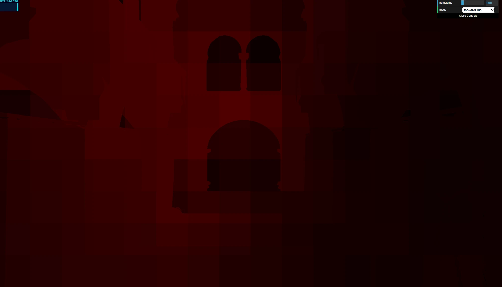 |

### Forward+

The fragment shader (`forward_plus.fs.wgsl`) finds its cluster from `@builtin(position)` and the
view-space depth, using the inverse of the slice formula, and loops over that cluster's lights. The
cluster is read through a pointer, so the 4 KB struct is never copied.

### Clustered Deferred

The clustering compute pass is reused unchanged. Rendering is split into two passes inside the same
command encoder.

* The G-buffer pass (`clustered_deferred.fs.wgsl`) draws the scene with the naive vertex shader and
  does no lighting.
  * It writes world position and normal as `rgba16float` (8 B each), albedo as `rgba8unorm` (4 B),
    plus the usual depth buffer.
  * Alpha-tested fragments are discarded here, so the fullscreen pass never sees them.
* The fullscreen pass (`clustered_deferred_fullscreen.vs/fs.wgsl`) draws one screen-covering
  triangle with `draw(3)` and no vertex buffer.
  * The fragment shader reads the three G-buffer textures with `textureLoad` at its own pixel.
  * It then runs the same cluster lookup and lighting loop as Forward+.
* The G-buffer textures live in their own bind group (`bindGroup_gbuffer`), next to the scene bind
  group that Forward+ already uses.

## Naive vs. Forward+ vs. Clustered Deferred

All timings are wall-clock milliseconds per frame from the in-page benchmark, at 2560 x 1271 and the
default camera position. [Benchmark method](#benchmark-method) describes how they are measured and
what to watch out for at low light counts.

Wall-clock time, cap 1024, median of 12 rounds from four sessions.

| Lights | Naive (ms) | range | Forward+ (ms) | range | Deferred (ms) | range | F+ vs naive | Deferred vs naive | Deferred vs F+ |
|---:|---:|---|---:|---|---:|---|---:|---:|---:|
| 500  | 36.0  | 34.9-36.5   | 6.0  | 4.9-6.0   | 3.2 | 3.1-3.5  | 6.0x  | 11.3x | 1.9x |
| 1000 | 71.0  | 69.9-78.1   | 7.2  | 6.1-8.2   | 3.5 | 3.1-3.6  | 9.9x  | 20.3x | 2.1x |
| 2000 | 141.1 | 140.5-159.0 | 12.6 | 11.5-13.1 | 6.0 | 5.9-6.0  | 11.2x | 23.5x | 2.1x |
| 5000 | 351.8 | 350.5-360.9 | 29.5 | 28.0-30.5 | 9.0 | 8.4-10.0 | 11.9x | 39.1x | 3.3x |

Deferred at 500 and 1000 lights stayed at about 3 ms in all 12 rounds, and a later rerun with a
warm-up before every configuration measures 3.2 and 3.5 ms again. Sessions without the warm-up
often measure about 6 ms there, because the GPU lowers its clock at such a light load (see
[Low-load GPU clocks](#low-load-gpu-clocks)).

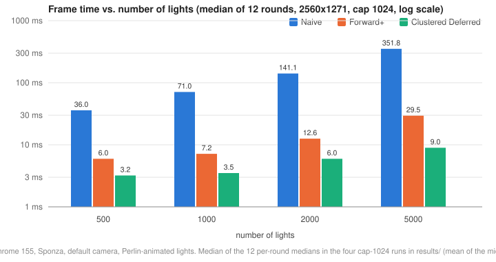

*Forward+ with the depth prepass was measured in a separate session, see
[Extra: Depth prepass](#extra-depth-prepass).*

> Of the three base renderers, Clustered Deferred is the fastest at every light count and Forward+
> is second. At 5000 lights Deferred takes 9.0 ms, Forward+ 29.5 ms and naive 351.8 ms.

GPU time per pass, from the main run (`results_cap1024_2560x1271_gpu_3rounds.csv`, median of 3
rounds). F+ is Forward+ and D is Deferred.

| Lights | Naive render | F+ clustering | F+ render | D clustering | D G-buffer | D fullscreen | F+ GPU total | D GPU total |
|---:|---:|---:|---:|---:|---:|---:|---:|---:|
| 500  | 34.0  | 0.20 | 2.95  | 0.26 | 0.66 | 0.79 | 3.08  | 1.77 |
| 1000 | 67.6  | 0.33 | 4.92  | 0.33 | 0.46 | 1.11 | 5.24  | 1.84 |
| 2000 | 138.3 | 0.66 | 10.22 | 0.66 | 0.46 | 2.36 | 10.88 | 3.41 |
| 5000 | 348.8 | 1.64 | 24.90 | 1.57 | 0.46 | 6.10 | 26.54 | 8.13 |

### Scaling with the light count

> On the GPU, all three lighting passes grow close to linearly with the light count (7.7x to 10.3x
> for 10x the lights). Clustering lowers the cost per light. It does not change the shape of the
> curve.

From 500 to 5000 lights (10x):

* Naive render grows 10.3x, about 0.070 ms per light.
* Forward+ render grows 8.4x and Deferred fullscreen 7.7x.
  * Both still contain a fixed part. With the geometry estimate from
    [Forward+ vs. Deferred lighting](#forward-vs-deferred-lighting) subtracted, the Forward+
    lighting grows 9.8x (2.49 to 24.44 ms).
  * The geometry estimate at 500 lights is uncertain, so treat the 9.8x as approximate.
* On the wall clock, Forward+ grows only 4.9x and Deferred 2.8x. That is mostly the fixed overhead
  and the geometry cost being spread over more lighting work.

This is expected for this scene. The lights are spread over the whole atrium, so the number of
lights per cluster grows in proportion to the total. The readback confirms it.

* Going from 2000 to 5000 lights (2.5x), the average non-empty cluster goes from 103 to about 250
  lights, and the busiest cluster from 344 to about 825. Both grow about 2.4x.

### Clustering cost

> The clustering pass costs about 0.33 ms per 1000 lights. At 5000 lights that is 6% of the Forward+
> GPU time but 19% of the Deferred GPU time.

The pass is O(clusters x lights), and the number of clusters is fixed, so its time is linear in the
light count.

* At 5000 lights it runs 3456 x 5000 = 17.3 M sphere/box tests in 1.64 ms, each with a
  `mat4 x vec4` to move the light into view space.
* Changing the cap to 2048 does not change it, so the size of the cluster buffer does not matter here.

### Forward+ vs. Deferred lighting

> Forward+ spends about 4x as much GPU time on lighting as Deferred, at every light count from 1000
> up. Most of this is overdraw (see [Extra: Depth prepass](#extra-depth-prepass)).

To compare only the lighting, the G-buffer pass time (0.46 ms) is subtracted from the Forward+ render
pass as an estimate of its non-lighting work.

* This assumes the two cost about the same. Both sample the albedo texture. The G-buffer pass
  writes 20 B per pixel, while Forward+ writes 4 B but runs the lighting loop in the same invocation.
* It also assumes one run of the loop costs the same in both shaders. Register use and occupancy
  can differ between them, so the ratio is an approximate run count.

| Lights | F+ render minus geometry | D fullscreen | ratio |
|---:|---:|---:|---:|
| 1000 | 4.46  | 1.11 | 4.0x |
| 2000 | 9.76  | 2.36 | 4.1x |
| 5000 | 24.44 | 6.10 | 4.0x |

* At 500 lights the ratio is 3.2x, but it depends strongly on the geometry estimate there (2.9x if
  0.66 ms is subtracted instead), so I do not use it.
* The ratio stays constant while the light count grows 5x. Two known effects make Forward+ run the
  loop more than once per pixel.
  * Overdraw. Forward+ has no depth prepass, so a pixel can be shaded several times before the
    final surface wins the depth test.
  * Quad overshading. Fragments are shaded in 2x2 quads, so small triangles shade extra helper
    pixels at their edges. The fullscreen pass has almost none of this.
* A depth prepass removes the overdraw, so it separates the two.
  [Extra: Depth prepass](#extra-depth-prepass) measures it.

This is also consistent with the wall-clock ratio between the two growing from 1.9x to 3.3x. At low
light counts the fixed overhead and geometry dominate both modes. As the lighting grows, the ratio
moves toward the 4x of the lighting alone.

### G-buffer cost

> The whole G-buffer pass takes 0.46 to 0.66 ms. That is cheap enough for Deferred to be faster than
> Forward+ even at 500 lights.

* At 500 lights the Deferred GPU total is 1.77 ms and the Forward+ total is 3.08 ms.
* The G-buffer is 2560 x 1271 x 20 B, about 65 MB written per frame and read back once by the
  fullscreen pass. The 0.46 ms includes drawing the geometry, so the bandwidth part is smaller still.

### Trade-offs beyond speed

Deferred wins on speed here, but it gives up some things that Forward+ keeps.

* The G-buffer stores one surface per pixel, so blended transparent surfaces cannot go through it
  and would need a separate forward pass. Sponza only uses alpha testing, which works in both.
* Hardware MSAA does not carry over directly. The G-buffer would have to be multisampled and lit per
  sample, which multiplies its memory and the lighting cost. Forward+ only needs MSAA turned on.
* The three full-screen targets take about 65 MB at 2560 x 1271 on top of the depth buffer. Forward+
  only needs a color and a depth target.
* Deferred needs two render passes, an extra bind group and G-buffer formats that both shaders must
  agree on, so it is more code to write and keep in sync.
* Forward+ with the depth prepass keeps all of these advantages and closes most of the gap: 12.0 ms
  against 9.8 ms for Deferred at 5000 lights, down from 28.1 ms without the prepass.

Clustering itself has costs that both clustered renderers pay.

* The cluster buffer takes 14.2 MB at cap 1024, and 28.3 MB at cap 2048.
* A cap that is too small silently drops lights (see [Cluster cap](#cluster-cap)).
* The clustering pass adds about 0.33 ms per 1000 lights every frame.

### Best and worst cases

Forward+ against naive:

* Best case: many lights spread over the scene, so each cluster holds a small share of them. The
  speedup grows from 6.0x at 500 lights to 11.9x at 5000.
* Worst case: very few lights, where the clustering pass and the fixed overhead dominate. With
  1 light Forward+ takes 3.4 and 5.0 ms (median of two sessions) and naive 3.0 ms.
* Lights large enough to touch every cluster would also remove the gain, since every fragment would
  loop over all lights again. The light radius is fixed at 2, so this was not measured.

Clustered Deferred against Forward+:

* Best case: many lights and a lot of overdraw. Deferred is 3.75x faster at 5000 lights in the
  far-end view (see [Camera view](#camera-view)).
* Worst case: few lights, where both are close to the 3 ms minimum. Deferred is still 1.9x faster at
  500 lights, but against Forward+ with a prepass it is within 0.2 ms up to 2000 lights, apart from
  one wall-clock step at 1000 lights (see [Camera view](#camera-view)).
* Scenes with blended transparency or MSAA lose part of the benefit, because those parts need a
  forward path anyway.

### Which workloads suit which

* More lights favor both clustered renderers, and Deferred's lead over Forward+ grows from 1.9x at
  500 lights to 3.3x at 5000.
* More overdraw favors Deferred and Forward+ with a prepass, since both light each pixel about once.
* At a few hundred lights Deferred and Forward+ with a prepass are both near the 3 ms minimum, and
  the choice between them matters little on this GPU.
* Transparency, MSAA or a tight memory budget favor Forward+, best with the prepass.

## Extra: Depth prepass

### Implementation

`forward+ prepass` is a separate render mode, so it can run next to plain Forward+ in the same
benchmark session.

* A first pass draws the scene depth-only. Its fragment shader (`depth_prepass.fs.wgsl`) only does
  the alpha test and there is no color target.
* The main pass then uses `depthWriteEnabled: false` and `depthCompare: "equal"`, so only the
  visible surface of each pixel runs the lighting loop.
* The vertex position output is marked `@invariant`. Without it the two pipelines are not
  guaranteed to produce the same depth, and `"equal"` could fail on some pixels.

### Results

> The prepass cuts the Forward+ render pass to about a third at every light count and makes Forward+
> 2.0x to 2.3x faster from 2000 lights up in this session (2.2x to 2.6x in the warm-up session). At
> 5000 lights it still trails Deferred (12.0 vs 9.8 ms).

All four modes were run in one session (`results_4modes_cap1024_2560x1271_gpu_3rounds.csv`, median
of 3 rounds). Wall clock and GPU times in ms.

| Lights | F+ wall | F+ prepass wall | F+ render | F+ prepass render | prepass | F+ GPU total | F+ prepass GPU total |
|---:|---:|---:|---:|---:|---:|---:|---:|
| 500  | 6.0  | 3.1  | 3.02  | 1.05 | 0.46 | 3.21  | 1.77 |
| 1000 | 6.8  | 3.5  | 4.92  | 1.44 | 0.26 | 5.24  | 2.03 |
| 2000 | 12.1 | 6.0  | 9.77  | 3.28 | 0.26 | 10.42 | 4.19 |
| 5000 | 28.1 | 12.0 | 24.51 | 8.06 | 0.26 | 26.15 | 9.90 |

* With the prepass, the render pass takes 0.29x to 0.35x of its time without it.
* The prepass itself costs 0.26 ms from 1000 lights up, less than the G-buffer pass (0.46 ms).
* At 500 and 1000 lights the prepass version sits near the 3 ms minimum (see
  [Fixed overhead](#fixed-overhead)), so the wall clock understates the gain. On the GPU it is
  1.8x and 2.6x faster.
* A separate 5000-light run (`results_prepass_cap1024_2560x1271_5000lights_3rounds.csv`) gives
  27.2 ms without and 11.6 ms with the prepass.

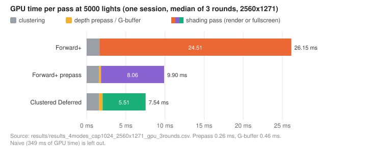

The same comparison over the light count, from the warm-up session in the default view:

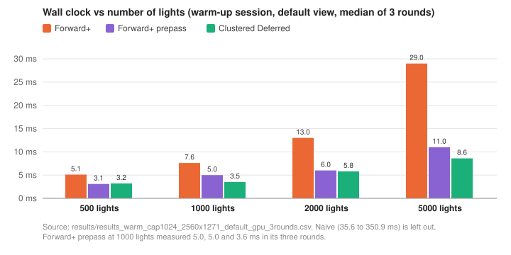

The prepass also splits the 4x lighting ratio from
[Forward+ vs. Deferred lighting](#forward-vs-deferred-lighting). Again 0.46 ms of geometry is
subtracted from each render pass, and Deferred comes from the same session.

| Lights | F+ lighting | F+ prepass lighting | removed by prepass | D fullscreen | F+ prepass vs D |
|---:|---:|---:|---:|---:|---:|
| 2000 | 9.31  | 2.82 | 3.3x | 2.29 | 1.2x |
| 5000 | 24.05 | 7.60 | 3.2x | 5.51 | 1.4x |

> Overdraw accounts for about 3.2x to 3.6x in the default view, depending on the session, and 4.1x
> to 4.6x at the far end (see [Camera view](#camera-view)). With it removed, Forward+ still spends
> 1.1x to 1.4x as much time on lighting as Deferred.

* 500 and 1000 lights are left out. Deferred at 1000 lights ran at the lower clock in this session
  (fullscreen 1.57 ms instead of 1.11 ms in the main run), and 500 lights depends too much on the
  geometry estimate.
* At 5000 lights the GPU totals are 9.90 ms for Forward+ prepass and 7.54 ms for Deferred. About
  2.1 ms of the 2.36 ms gap is lighting (7.60 vs 5.51 ms). The extra geometry pass adds little,
  since the prepass is cheaper than the G-buffer pass.

Best and worst cases:

* Best case: a lot of overdraw. The prepass removes 4.1x to 4.6x of the lighting work in the
  far-end view, against 3.2x to 3.6x in the default view.
* Worst case: little overdraw or very heavy geometry, where drawing the scene twice costs more than
  it saves. In Sponza the extra pass costs 0.26 to 0.46 ms, so this case did not come up. At low
  light counts the gain is real but hidden by the 3 ms minimum.

Trade-offs:

* The geometry is drawn twice.
* Both pipelines must produce the same depth, which needs `@invariant` on the vertex position.
* The alpha test runs in both passes.

## Extra: Cluster culling

### Implementation

`forward+ prepass cull` and `clustered deferred cull` only assign lights to clusters that contain a
visible surface.

* A compute pass (`mark_clusters.cs.wgsl`) runs one thread per pixel over the depth buffer, from the
  prepass for Forward+ and from the G-buffer pass for Deferred.
  * It does the same per-pixel work as a fullscreen-quad pass would, without needing a render
    target.
  * Each thread finds the cluster of its pixel's surface and sets a flag for it.
  * The flags are cleared with `clearBuffer` at the start of every frame.
* The clustering shader has an `override cullClusters` constant. The culled pipeline sets it and
  skips every cluster without a flag, leaving its light count at 0.
* Inactive clusters are skipped inside the clustering shader. There is no stream compaction, so the
  dispatch size stays at 3456 threads.
* In these modes the clustering pass runs after the depth is written instead of at the start of the
  frame.

### Results

> Culling removes 85% of the non-empty clusters, but the clustering pass still takes 1.57 ms. Its
> time is set by how long each thread's loop over all lights takes, not by the number of threads.

Readback at 5000 lights in the default view with `forward+ prepass cull`, 20 samples over 10 s:

* 287 clusters are active, 8% of all 3456, against about 1946 non-empty clusters without culling.
* All of them are in slices 7 to 13 (depth 1.5 to 21.5). No visible surface is closer than slice 7,
  although without culling the clusters there hold up to about 300 lights each.
* The active clusters hold 379 lights on average, against about 250 over all non-empty clusters
  without culling.

Timing at 5000 lights, culling on and off in the same session
(`results_cull_cap1024_2560x1271_5000lights_gpu_3rounds.csv`, median of 3 rounds, ms).

| Mode | Wall | Clustering | Mark | Render / fullscreen | GPU total |
|---|---:|---:|---:|---:|---:|
| Forward+ prepass         | 11.0 | 1.57 | -    | 7.21 | 9.04 |
| Forward+ prepass, culled | 12.0 | 1.57 | 0.07 | 7.80 | 9.70 |
| Deferred                 | 10.1 | 1.57 | -    | 6.23 | 8.19 |
| Deferred, culled         | 9.7  | 1.57 | 0.07 | 5.37 | 7.41 |

* The clustering pass takes 1.573 ms in all 12 rows. The mark pass takes one timestamp step.
* Forward+ with culling is slower in all three rounds, by 0.5 to 1.0 ms on the wall clock and 0.1 to
  1.0 ms in its render pass.
* The Deferred difference falls within the two levels its fullscreen pass shows without culling
  (5.3 and 6.2 to 6.4 ms, see [Variation between rounds and sessions](#variation-between-rounds-and-sessions)),
  so it cannot be credited to culling.

The clustering pass uses one thread per cluster, 3456 threads in 27 workgroups.

* The RTX 3090 Ti has 84 SMs, so all 27 workgroups run at once and most of the GPU sits idle.
* Every active thread loops over all 5000 lights, so the pass takes as long as one warp needs for
  that loop, about 315 ns per light.
* Culling removes threads but not loop iterations. This is also why the pass time does not change
  with the cap and grows linearly with the light count.
* The grid sweep shows the same thing over a 14x range of cluster counts: the clustering pass takes
  1.57 to 1.64 ms for 960 to 13824 clusters (see [Cluster grid](#cluster-grid)).
* Stream compaction would not help in this structure either. It would dispatch fewer threads, but
  the threads it removes are the ones that already return early.

Best and worst cases:

* With the current clustering pass there is no best case. Culling was only measured at 5000
  lights, and it does not speed the pass up there.
* Worst case: Forward+ with culling, which is 0.5 to 1.0 ms slower per frame at 5000 lights.
* Culling would help most once the clustering pass is limited by its total work instead of by one
  thread's loop, and the fewer clusters hold visible surfaces, the more it would save.

Trade-offs:

* It adds a mark pass (0.07 ms at 2560 x 1271) and a buffer clear every frame.
* Clustering has to wait until the depth is written, so Forward+ can only cull with the prepass.

## Parameters

Three parameters were varied besides the light count: the cluster grid, the cluster cap and the
camera view.

### Cluster grid

The grid size is a compile-time constant, so each grid was measured in its own page session after
changing `clusterDimX/Y/Z` (`results_grid_*_warm_cap1024_2560x1271_5000lights_3rounds.csv`). The
16 x 9 x 24 numbers come from the warm-up run in the default view. All runs use 5000 lights, the
default view and the warm-up, median of 3 rounds. Since every grid is a separate session,
differences of a few tenths of a millisecond are not meaningful.

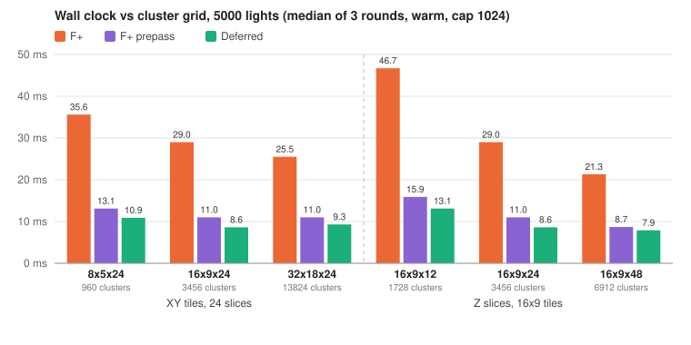

| Grid | Clusters | Buffer | F+ wall | F+ render | F+ prepass wall | F+ prepass render | Deferred wall | D fullscreen |
|---|---:|---:|---:|---:|---:|---:|---:|---:|
| 8 x 5 x 24   | 960   | 3.9 MB  | 35.6 | 31.59 | 13.1 | 9.11  | 10.9 | 6.42 |
| 16 x 9 x 24  | 3456  | 14.2 MB | 29.0 | 25.23 | 11.0 | 7.27  | 8.6  | 5.11 |
| 32 x 18 x 24 | 13824 | 56.7 MB | 25.5 | 21.69 | 11.0 | 7.14  | 9.3  | 5.64 |
| 16 x 9 x 12  | 1728  | 7.1 MB  | 46.7 | 43.12 | 15.9 | 11.53 | 13.1 | 9.24 |
| 16 x 9 x 48  | 6912  | 28.3 MB | 21.3 | 17.30 | 8.7  | 5.18  | 7.9  | 3.87 |

> More depth slices help much more than more tiles. Going from 24 to 48 slices cuts the Forward+
> render pass by 31% and the Deferred fullscreen pass by 24%. Going from 16 x 9 to 32 x 18 tiles
> cuts the Forward+ render pass by 14% and gives no further gain for the other two modes.

The reason is the shape of a cluster.

* At depth d, a 16 x 9 x 24 cluster is about 0.10d wide, 0.09d tall and 0.47d deep (45 degree
  vertical field of view, aspect ratio 2.0, exponential slices). It is about 5x longer in depth
  than across.
* A light of radius 2 reaches a cluster if its center is within 2 units of the cluster's box, so the
  number of lights per cluster grows roughly with (w + 4)(h + 4)(dz + 4). The longest side
  dominates this product.
* A rough estimate at d = 10 follows the measured order and comes close in size:

| Grid | Estimated lights per cluster | Measured F+ render |
|---|---:|---:|
| 8 x 5 x 24   | +39% | +25% |
| 32 x 18 x 24 | -19% | -14% |
| 16 x 9 x 12  | +79% | +71% |
| 16 x 9 x 48  | -30% | -31% |

* At 32 x 18 a tile is about 0.5 units wide at d = 10, much smaller than a light's diameter of 4.
  The light size then sets how many lights a cluster holds, so smaller tiles save little.

The clustering pass takes 1.57 to 1.64 ms for every grid from 960 to 13824 clusters. Even 13824
threads (108 workgroups) run at once, so, as in [Extra: Cluster culling](#extra-cluster-culling),
the pass time is set by each thread's loop over the 5000 lights. In this implementation a finer grid
costs buffer memory, not clustering time.

For this scene 16 x 9 x 48 is faster than the default in all three modes (Forward+ 21.3 vs 29.0 ms,
prepass 8.7 vs 11.0 ms, Deferred 7.9 vs 8.6 ms), at twice the buffer memory. All other results in
this README use 16 x 9 x 24.

### Cluster cap

The cap (`maxLightsPerCluster`) limits how many lights a cluster can hold. If it is too small,
lights are silently dropped. If it is too large, the cluster buffer grows. Two tools show where the
cap is reached.

* The heatmap debug view shows it on screen.
* `clusterStats()` reads the cluster buffer back. I ran it with 20 samples spread over 10 s, because
  the light layout changes over time and consecutive frames only show one moment.

| 2000 lights, cap 256 | 5000 lights, cap 256 | 5000 lights, cap 1024 |
|---|---|---|
| 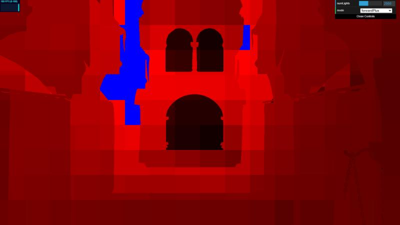 | 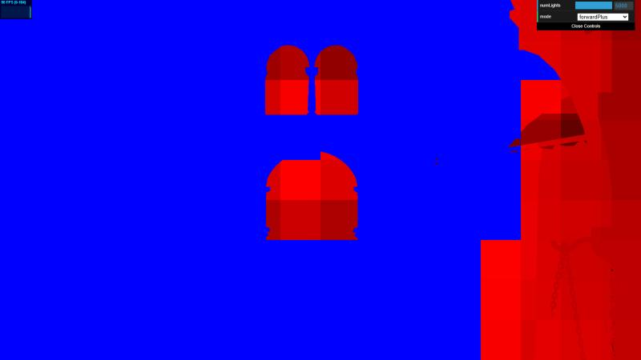 | 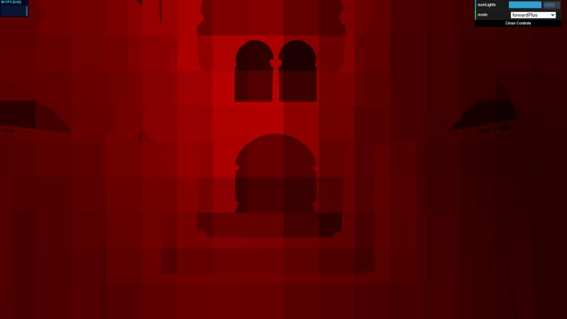 |

*Red intensity is `numLights / cap`. Blue means the cluster has reached the cap. Each image is a
single frame.*

#### How full the clusters get

Readback at 5000 lights, 20 samples over 10 s. About 1946 of the 3456 clusters are non-empty.

| Cap | Full clusters, median | Full clusters, peak | Busiest cluster, median | Busiest cluster, peak | Buffer |
|---:|---:|---:|---:|---:|---:|
| 256  | 663 (34%) | 1575 (81%) | 256 | 256  | 3.6 MB  |
| 512  | 99 (5%)   | 330 (17%)  | 512 | 512  | 7.1 MB  |
| 1024 | 0         | 52 to 57 (3%) | 824 to 827 | 1024 | 14.2 MB |
| 2048 | 0         | 0          | 842 | 1345 | 28.3 MB |

*Percentages are of the non-empty clusters. Cap 1024 was sampled twice, and both results are shown.*

> In the default view at 5000 lights, a cap of 1024 drops lights only at peak moments, in at most 3%
> of the clusters. Within the sampled 10 s, 2048 is the smallest power of two that never drops a
> light there.

* The busiest cluster usually holds about 825 lights, 80% of a 1024 cap. The heatmap image above
  shows no full cluster, which fits a typical moment.
* At 2000 lights (cap 1024) the busiest cluster holds 344 lights at the median and 539 at the peak.
  * So a cap of 256 already drops lights at 2000 lights in a typical frame, which matches the blue
    clusters in the first heatmap.
  * A cap of 512 would only be exceeded at peak moments.
  * Both points follow from the cap-1024 readback. I did not read back at cap 256 or 512 with
    2000 lights.

#### Effect on timing

Wall clock from the four sessions that alternated between the two caps (ms, one session per column).

| Lights | F+ 256 | F+ 1024 | F+ 256 | F+ 1024 | D 256 | D 1024 | D 256 | D 1024 |
|---:|---:|---:|---:|---:|---:|---:|---:|---:|
| 500  | 5.9  | 6.0  | 6.0  | 5.9  | 3.1 | 3.1 | 3.1 | 3.1 |
| 1000 | 6.4  | 6.6  | 6.2  | 7.2  | 3.5 | 3.5 | 3.4 | 3.5 |
| 2000 | 12.4 | 12.2 | 12.1 | 12.0 | 6.0 | 6.0 | 6.0 | 5.9 |
| 5000 | 19.5 | 29.2 | 19.5 | 29.6 | 7.0 | 8.9 | 7.9 | 8.7 |

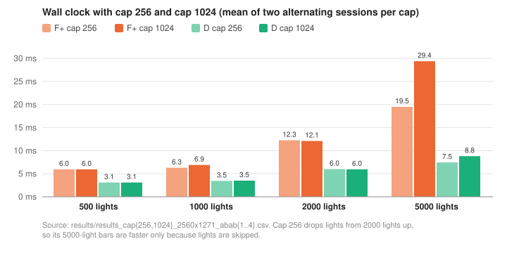

> Up to 2000 lights the cap has no measurable effect on timing. At 5000 lights cap 256 looks much
> faster, but only because a third or more of the non-empty clusters are cut off.

* An earlier pair of sessions showed Forward+ at 500 lights about 1 ms faster with cap 1024. In the
  alternating runs that difference is gone, so it was variation between sessions.
* At 5000 lights cap 256 saves Forward+ about 10 ms but Deferred only 0.8 to 1.9 ms, partly because
  Forward+ walks each cluster list several times per pixel.
* Even so, the correct Deferred (about 9 ms) is faster than the incorrect Forward+ at cap 256
  (19.5 ms).

Cap 2048 at 5000 lights gives Forward+ 29.0 ms and Deferred 9.0 ms, inside the cap-1024 ranges
(28.0 to 30.5 and 8.4 to 10.0). The few lights that 1024 drops at peak moments have no measurable
effect on timing, so the main table measured at cap 1024 stands. The code uses 1024 by default. 2048
removes the remaining drops at the cost of a 28.3 MB buffer.

The right cap also depends on the view. In the second camera view (see
[Camera view](#camera-view)), the readback with culling finds 6 full clusters at the median and 26
at the peak, against 0 and 18 in the default view, so a cap of 1024 already drops lights in a
typical frame there.

### Camera view

Both views were measured with the warm-up, in two sessions run one after the other
(`results_warm_cap1024_2560x1271_default_gpu_3rounds.csv` and
`results_warm_cap1024_2560x1271_far-end-diag_gpu_3rounds.csv`). The second view, `far-end-diag`,
looks back from the far end of the atrium (pos [7.90, 2.02, -1.36], yaw 162.2, pitch -3.0).

Wall clock, median of 3 rounds (ms).

| Lights | Naive default | Naive far end | F+ default | F+ far end | F+ prepass default | F+ prepass far end | Deferred default | Deferred far end |
|---:|---:|---:|---:|---:|---:|---:|---:|---:|
| 500  | 35.6  | 37.0  | 5.1  | 5.7  | 3.1  | 3.2  | 3.2 | 3.1 |
| 1000 | 70.3  | 72.7  | 7.6  | 7.7  | 5.0  | 3.6  | 3.5 | 3.6 |
| 2000 | 140.0 | 144.8 | 13.0 | 13.0 | 6.0  | 5.9  | 5.8 | 6.0 |
| 5000 | 350.9 | 362.3 | 29.0 | 30.0 | 11.0 | 10.2 | 8.6 | 8.0 |

> In both views the GPU-time ranking is the same: Deferred, then Forward+ prepass (equal at 500
> lights), then Forward+, then naive. The far-end view has more overdraw, so Forward+ without a
> prepass falls further behind: at 5000 lights Deferred is 3.75x faster than it, against 3.4x in the
> default view.

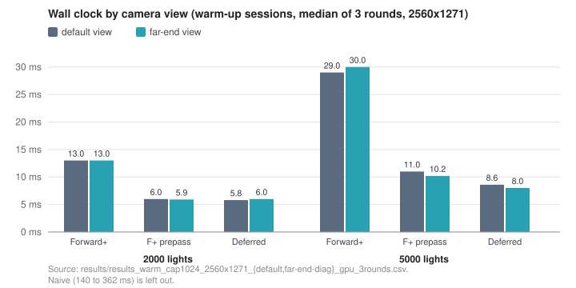

* On the GPU the gap between Deferred and Forward+ prepass grows with the light count (5000 lights:
  7.14 vs 9.11 ms in the default view, 6.62 vs 8.65 ms at the far end).
* On the wall clock the two are within 0.2 ms up to 2000 lights. The exception is Forward+ prepass
  at 1000 lights in the default view, which measures 5.0, 5.0 and 3.6 ms in its three rounds with
  a GPU time of 2.2 to 2.5 ms.
* Naive, which shades every fragment, is 3% slower at the far end (GPU 360.1 vs 348.5 ms at 5000
  lights).

The prepass removes more overdraw at the far end. Same method as in
[Extra: Depth prepass](#extra-depth-prepass), with 0.46 ms of geometry subtracted from each render
pass.

| Lights | View | F+ lighting | F+ prepass lighting | removed by prepass | D fullscreen | F+ prepass vs D |
|---:|---|---:|---:|---:|---:|---:|
| 2000 | default | 10.09 | 2.82 | 3.6x | 2.62 | 1.1x |
| 2000 | far end | 10.35 | 2.23 | 4.6x | 1.97 | 1.1x |
| 5000 | default | 24.77 | 6.81 | 3.6x | 5.11 | 1.3x |
| 5000 | far end | 25.95 | 6.29 | 4.1x | 4.52 | 1.4x |

* The default view measured 3.2x to 3.3x in the earlier four-mode session, so this ratio moves by a
  few tenths between sessions. The far-end view is higher in both light counts.
* After the prepass, Forward+ still spends 1.1x to 1.4x as much time on lighting as Deferred in
  both views.

Cluster load with culling at 5000 lights (`cluster_stats_far-end-diag_view.csv`, 20 samples over
10 s):

* 310 clusters are active at the far end, in slices 4 to 13, against 287 in slices 7 to 13 in the
  default view. Some visible surfaces are within 1.5 units of the camera there.
* They hold 325 lights on average, against 379 in the default view.
* 6 clusters are full at the median and 26 at the peak, against 0 and 18. The busiest cluster in
  slice 12 is at the cap in the median sample.

## Benchmark method

All timings come from the in-page benchmark in `src/benchmark.ts`, run from the browser console at
the default camera position (pos [-7, 2, 0], yaw 0, pitch 0). Results are in milliseconds per frame.

```
await benchmark()                                    // full sweep: 500 / 1000 / 2000 / 5000 lights
await benchmark({ lightCounts: [1] })                // fixed overhead
await clusterStats({ numLights: 5000, frames: 20 })  // cluster readback, 20 samples 0.5 s apart
await clusterStats({ numLights: 5000, frames: 20, mode: 'forward+ prepass cull' })  // with culling
await benchmark({ warm: true })                      // warm-up before every configuration
await benchmark({ view: 'far-end-diag', camera: { pos: [7.90, 2.02, -1.36], yaw: 162.2, pitch: -3.0 }, warm: true })
```

While the benchmark runs, the render loop switches to a serialized path (`Renderer.timedFrame` in
`src/renderer.ts`). One sample is measured like this:

1. Wait for the light-movement compute pass to finish, so it is not counted.
2. Record `performance.now()`, call `draw()`, and wait for `queue.onSubmittedWorkDone()`.
3. The elapsed time is the sample. It covers CPU command encoding, GPU execution and the submit and
   completion latency of one frame, with only one frame in flight.

Each pass also writes GPU timestamps (`timestamp-query`), which give the GPU time per pass.

* The timestamps are mapped and read after the wall clock has stopped. Only the resolve and copy
  commands are recorded inside the timed frame.
* The GPU times come in steps of about 0.066 ms, and `performance.now()` has a resolution of 0.1 ms.

Samples are aggregated in three steps.

* For every (lights, mode) pair, 30 warm-up frames are discarded and the median of the next 200
  frames is kept, for both the wall clock and each GPU pass.
* The whole sweep is repeated 3 times per page session. Modes for the same light count run back to
  back, so slow drift such as heating affects every mode about equally. The faster clock drop at
  low load is a separate effect (see [Low-load GPU clocks](#low-load-gpu-clocks)).
* The main comparison pools four separate cap-1024 sessions, 12 rounds in total. The reported value
  is the median of the 12 per-round medians (the mean of the middle two), and the range is their
  min and max.
* With `warm: true`, every configuration starts with 6 frames of naive at 5000 lights, about 2 s at
  full load, to keep the GPU clock up for the measured frames. The two camera-view runs and the
  grid sweep use it. Clocks were not logged for the camera-view runs, but their clustering pass at
  1000 lights takes 0.33 ms, the high-clock value.

All runs are at 2560 x 1271 (maximized Chrome window, DevTools undocked). Every CSV row stores the
canvas size and the cluster cap, and only runs at the same canvas size are compared. The canvas
size is fixed when the page loads, so reload after changing the window and check the first line the
benchmark prints.

Raw data in `results/`:

```
results_cap1024_2560x1271_gpu_3rounds.csv             # main run with per-pass GPU times
results_cap1024_2560x1271_3rounds.csv                 # cap 1024, earlier session
results_cap1024_2560x1271_abab2.csv / abab4.csv       # cap 1024, alternating with cap 256
results_cap256_2560x1271_abab1.csv / abab3.csv        # cap 256, alternating with cap 1024
results_cap256_2560x1271_3rounds.csv                  # cap 256, earlier session
results_cap2048_2560x1271_5000lights_gpu_3rounds.csv  # cap 2048, 5000 lights only
results_1light_cap1024_2560x1271_gpu_3rounds.csv      # 1 light, fixed overhead
results_1light_cap1024_2560x1271_3rounds.csv          # 1 light, repeat without GPU columns
cluster_stats_default_view.csv                        # cluster buffer readback, per cap and culling
cluster_stats_per_slice_default_view.csv              # same, per depth slice
results_cull_cap1024_2560x1271_5000lights_gpu_3rounds.csv  # culling on and off, 5000 lights
results_4modes_cap1024_2560x1271_gpu_3rounds.csv      # all four modes, including Forward+ prepass
results_prepass_cap1024_2560x1271_5000lights_3rounds.csv  # Forward+ with and without prepass, repeat
results_lowload_clock_drift_prepass500.csv            # low load, 4 rounds with start times
gpu_clocks_lowload_clock_drift.csv                    # nvidia-smi clocks during the run above
results_heavy_light_alternation_2560x1271.csv         # heavy and light configurations alternating
gpu_clocks_heavy_light_alternation_summary.csv        # summary of the nvidia-smi log for the run above
results_lowload_deferred_then_prepass_2560x1271.csv   # low load, Deferred first
results_lowload_prepass_then_deferred_2560x1271.csv   # low load, Forward+ prepass first
results_warm_cap1024_2560x1271_default_gpu_3rounds.csv     # warm-up, default view
results_warm_cap1024_2560x1271_far-end-diag_gpu_3rounds.csv  # warm-up, far-end view
cluster_stats_far-end-diag_view.csv                   # readback with culling, far-end view
cluster_stats_per_slice_far-end-diag_view.csv         # same, per depth slice
results_grid_8x5x24_warm_cap1024_2560x1271_5000lights_3rounds.csv    # grid sweep, 5000 lights
results_grid_32x18x24_warm_cap1024_2560x1271_5000lights_3rounds.csv  # grid sweep, 5000 lights
results_grid_16x9x12_warm_cap1024_2560x1271_5000lights_3rounds.csv   # grid sweep, 5000 lights
results_grid_16x9x48_warm_cap1024_2560x1271_5000lights_3rounds.csv   # grid sweep, 5000 lights
```

### Fixed overhead

> Every frame pays about 1.5 to 3 ms on top of the GPU work, so no mode gets below about 3 ms of
> wall clock at this setup.

Wall clock minus GPU time is 1.5 to 3.2 ms in all 12 configurations of the main run, with no trend
across modes or light counts. It includes CPU command encoding, submit and completion latency, and
any gaps between passes that the timestamps do not cover.

* With 1 light, naive and Deferred take 3.0 to 3.2 ms of wall clock in the GPU run.
* The overhead does not simply add to the GPU time. While the GPU time stays below about 1.8 ms,
  the wall clock stays at 3.0 to 3.4 ms. Above that it is roughly GPU time plus 1.5 to 3 ms.
* GPU timings at very small loads are not reliable.
  * With 1 light, the GPU time of the same pass changes 2x to more than 3x between rounds (naive
    render 0.26 to 0.85 ms, G-buffer 0.72 to 1.44 ms, Forward+ render 0.66 to 2.03 ms).
  * Only Forward+ gets large enough to push the wall clock above 3 ms, so its wall clock shows
    two levels, 3.1 and 5.0 ms. The repeat file without GPU columns shows a similar split (3.4 and
    5.0 ms).
* The geometry cost is better taken from loaded runs. The G-buffer pass, which does no lighting,
  takes a steady 0.46 ms from 1000 lights up.

### Low-load GPU clocks

> When the GPU is busy for only about 1.2 to 1.6 ms per frame (the one configuration that was
> clock-logged), the driver lowers its clocks within about 3 s and the measured times go up. Without a warm-up, 500- and 1000-light results from different
> moments in a session are not comparable.

The serialized benchmark keeps the GPU only 20% to 40% busy at low light counts. I logged the clocks
with nvidia-smi next to the benchmark and aligned the two by timestamp
(`gpu_clocks_lowload_clock_drift.csv` and `results_lowload_clock_drift_prepass500.csv`).

* The run is Forward+ prepass at 500 lights, 4 rounds of 600 frames, started right after a fully
  loaded stretch.
  * About 3 s into round 1, the memory clock drops from 10251 to 5001 MHz and the SM clock from
    about 1980 to 750 to 1200 MHz.
  * Round 1, mostly at the high clock, has a GPU time of 1.57 ms. Rounds 2 to 4 stay at the low
    clock and have 2.49 to 2.95 ms.
* Heavy loads keep the clock up (`gpu_clocks_heavy_light_alternation_summary.csv`).
  * Naive at 500 and 5000 lights and Forward+ prepass at 5000 lights (about 9 ms of GPU time per
    frame) keep the memory clock at 10251 MHz and the SM clock between 1755 and 1980 MHz.
  * Forward+ prepass at 500 lights, run between them, drops within 3 s every time.
* Configurations between these two loads were not clock-logged. Their numbers repeat across
  sessions (Deferred at 2000 lights measures 5.9 to 6.0 ms in every session), so they do not look
  affected.

This decides which mode looks faster at low light counts. I ran Deferred and Forward+ prepass at
500 and 1000 lights in both orders (`results_lowload_*_then_*.csv`).

* In both orders, only the 500-light runs at the start of round 1 measure about 3 ms.
* Almost everything after that measures 5.6 to 6.0 ms, whichever mode it is.
* So the Deferred values of about 6 ms at 500 and 1000 lights in the four-mode run are low-clock
  numbers and are not used.
* With the warm-up, Deferred at 500 and 1000 lights measures 3.2 and 3.5 ms again.

The wall clock also moves in steps at low load, separately from the clock change.

* With 1 light, the GPU time changes between 0.3 and 1.5 ms while the wall clock stays at 3.0 to
  3.2 ms.
* In the clock log above, the GPU time rises by 0.9 to 1.4 ms, but the wall clock rises by 2.3 to
  2.5 ms (from 3.4 to 5.7 to 5.9 ms).
* At low load the wall clock mostly lands near 3, 5 or 6 ms.

Forward+ at 500 lights measures between 5.0 and 6.0 ms depending on the session. Its clustering
pass takes 0.20 ms in every run with GPU columns, the high-clock value (the same pass takes 0.33 ms
after the clock drops), so this is not the downclocking.

### Variation between rounds and sessions

* Across the four cap-1024 sessions, the per-session medians of Forward+ and Deferred agree within
  1.4 ms, and naive within 5%.
* Naive has two slow rounds in one session (78.1 ms at 1000 lights and 159.0 ms at 2000). The median
  removes them.
* Deferred at 5000 lights falls into two groups, 8.4 to 9.0 ms and 10.0 ms, and its fullscreen pass
  does the same on the GPU (5.2 and 6.1 to 6.3 ms). The light layout also changes over time (see
  [Cluster cap](#cluster-cap)), but the benchmark does not record it per round.

## Known limitations

* Only two camera positions were measured.
* The grid sweep only covers 5000 lights in the default view, and every other result uses the
  16 x 9 x 24 grid. Slices 15 to 23 of that grid never held a light in any readback sample at 5000
  lights in the default view. A tighter far plane would move those slices to where the lights are.
* The cap is fixed per cluster. A compacted index list (a prefix sum over the per-cluster counts)
  would remove it.
* At low load the serialized benchmark lets the GPU clock down. Only the camera-view runs and the
  grid sweep use the warm-up, so the earlier 500- and 1000-light results are only used where they
  match the high-clock state.
* The G-buffer could be smaller. It uses 20 B per pixel in three textures. Position could be
  rebuilt from depth and normals stored in two channels, so everything fits in one target.
* The prepass could be cheaper. Opaque materials do not need its fragment shader, only alpha-tested
  ones do.
* Culling only pays off once the clustering pass has more parallel work per cluster.
  * One option is a workgroup per cluster, with its threads splitting the lights and appending hits
    through an atomic counter. Another is a thread per light that writes into every cluster it
    overlaps.
  * After that, a prefix sum over the active flags would let an indirect dispatch launch work for
    the 287 active clusters only.

## Credits

- [Vite](https://vitejs.dev/)
- [loaders.gl](https://loaders.gl/)
- [dat.GUI](https://github.com/dataarts/dat.gui)
- [stats.js](https://github.com/mrdoob/stats.js)
- [wgpu-matrix](https://github.com/greggman/wgpu-matrix)
